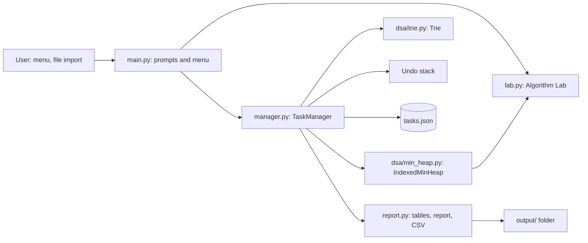

# PRIORITY BASED TASK MANAGER: A DSA-BASED CONSOLE SCHEDULER

**Always know what to do next. The most urgent task is the one that comes out first.**

A console application that keeps tasks in a priority queue. A binary min-heap, a hash map, a trie and an undo stack, all written from scratch, work together to add, find, change, undo and execute tasks quickly. The project runs on plain Python with no extra packages.

## Project highlights

| Area       | Implementation                                                          |
| ---------- | ----------------------------------------------------------------------- |
| Core       | Indexed binary min-heap (priority queue) written without `heapq`       |
| Lookup     | Hash map from task ID to heap position, O(1) access                     |
| Search     | Trie (prefix tree) over task words and IDs                              |
| Undo       | Stack of reverse operations, last action is undone first                |
| Input      | Keyboard, or import from CSV / TXT / JSON with row-by-row validation    |
| Output     | Tables, summary report (screen + file), CSV export                      |
| Learning   | Algorithm Lab: step-by-step heap visualiser and live benchmark          |
| Quality    | 33 unit tests, automatic saving, deadline alerts                        |
| Requirements | Python 3.6 or later, standard library only                            |

## Problem statement

A to-do list that is only a list forces you to decide again and again what to do next. Sorting it by hand is slow, and re-sorting after every change wastes work. This project keeps the list as a **priority queue** so the next task is always available instantly, and it adds the operations a real task manager needs (edit, delete, search, undo) without giving up that speed.

## System architecture



`main.py` only asks questions and prints. All rules live in `manager.py`, which has no `input()` or `print()`, so the same code is tested directly by the unit tests.

## Features

- Add tasks with a unique ID, name, priority 1-5 and an optional deadline.
- View pending tasks in execution order, with `OVERDUE`, `DUE TODAY` and `due tomorrow` flags.
- Execute the highest-priority task and move it to the completed history.
- Edit a task (Enter keeps the old value, type `none` to remove a deadline) or delete it.
- **Search** by word prefix using the trie, with a substring fallback.
- **Filter** by priority, overdue only, or due within N days.
- **Undo** the last 50 actions (add, execute, edit, delete, import, perform).
- Import tasks from CSV, TXT or JSON. Invalid rows are skipped and the reason is shown.
- Generate a report (shown on screen and saved in `output/`), and export everything to CSV.
- The report tells whether each completed task was finished **on time or late**.
- Data is saved automatically to `tasks.json` using a temporary file and rename, so a crash cannot leave a half-written file.

## Menu

| #  | Option                       | What it does                                                    |
| -- | ---------------------------- | --------------------------------------------------------------- |
| 1  | Add Task                     | New task, ID must be unique (case-insensitive)                  |
| 2  | View Tasks                   | Pending tasks in execution order, shows the next task           |
| 3  | Execute Highest Priority     | Removes the top task and records the completion date            |
| 4  | Edit Task                    | Change name, priority or deadline                               |
| 5  | Delete Task                  | Remove a task after confirmation                                |
| 6  | Search Tasks                 | Word-prefix search on ID and name                               |
| 7  | View Completed Tasks         | History with completion date and on time / late result          |
| 8  | Upload File & Perform Tasks  | Import a file, then optionally perform the imported tasks       |
| 9  | Generate Report              | Summary, priority bar chart, overdue list                       |
| 10 | Undo Last Action             | Reverses the most recent change                                 |
| 11 | Filter Tasks                 | Priority, overdue, or due within N days                         |
| 12 | Export to CSV                | All tasks to `output/tasks_export_<time>.csv`                   |
| 13 | Algorithm Lab                | Heap visualiser and benchmark                                   |
| 14 | Exit                         | Saves and quits                                                 |

## DSA algorithms and data structures used

| Data structure / algorithm        | Purpose in the project                                                                                  | Complexity                                    |
| --------------------------------- | ------------------------------------------------------------------------------------------------------- | --------------------------------------------- |
| **Binary min-heap** (`min_heap.py`) | Keeps pending tasks so the most urgent one is always at the root.                                     | push, pop: `O(log n)`; peek: `O(1)`           |
| **Hash map (position index)**     | Maps task ID to its position in the heap array. Lets edit and delete find a task without scanning.      | lookup `O(1)` expected                        |
| **Indexed heap update / remove**  | Fixes the heap with one sift-up or sift-down after a change in the middle.                              | `O(log n)` (the first version rebuilt the heap in `O(n)`) |
| **Heap sort on a copy**           | Produces the full execution order for the table without changing the real queue.                        | `O(n log n)`                                  |
| **Trie** (`trie.py`)              | Finds tasks whose words start with the typed text without reading every task.                           | insert / remove `O(L)`; search `O(L + k)`     |
| **Stack** (`collections.deque`)   | Holds one reverse operation per action, so undo replays them last-in first-out.                         | push / pop `O(1)`; undoing an action costs `O(log n)` |
| **Binary search (bisect)**        | Used only in the benchmark, as the sorted-list competitor.                                              | insert `O(n)`                                 |

Here `n` is the number of pending tasks, `L` the length of the typed word and `k` the number of matches. Search also sorts its `k` results, which adds `O(k log k)`. The substring fallback scans all tasks, `O(n)`.

## How tasks are ordered

The heap compares the key `(-priority, deadline, order)`:

1. Higher priority first (5 = Critical ... 1 = Very Low). Priority is stored as a negative number because a min-heap puts the smallest value first.
2. If priorities are equal, the earlier deadline first. A task without a deadline counts as `9999-12-31`, so it comes after tasks that have one.
3. If both are equal, the task added first goes first. `order` is a counter that never repeats, so two tasks never have the same key.

## Worked example

Tasks pushed in this order (this is the fixed example used by the Algorithm Lab):

| Task | Priority | Deadline   |
| ---- | -------- | ---------- |
| A    | 3        | 2026-11-20 |
| B    | 5        | 2026-11-25 |
| C    | 5        | 2026-11-15 |
| D    | 1        | none       |
| E    | 4        | 2026-11-18 |
| F    | 5        | 2026-11-15 |

- After the first two pushes, B beats A and moves to the root.
- C has the same priority as B but an earlier deadline, so C swaps with B and becomes the root.
- F ties with C on priority and deadline, but C was added first, so C stays on top.
- Popping gives **C, F, B, E, A, D**. The most urgent task always leaves first, and each pop needs at most `log n` swaps.

Run menu option 13, then 1, to watch every swap. The full output is in [`docs/sample_session.txt`](docs/sample_session.txt).

## Run locally

```
python main.py
```

On Windows you can also use `py main.py`. Python 3.6 or later is needed and nothing has to be installed.

### Upload file format (option 8)

```
id,name,priority,deadline
S1,Prepare project presentation,5,14-11-2026
S2,Submit lab record,4,12-11-2026
S5,Clean up desktop files,1,
```

- The header line is optional and the deadline may be empty.
- Dates can be `DD-MM-YYYY`, `DD/MM/YYYY` or `YYYY-MM-DD`.
- JSON files with a list of `{id, name, priority, deadline}` objects also work, and so does a `tasks.json` saved by this program.
- Rows with a missing ID or name, a priority outside 1-5, an invalid date or a duplicate ID are skipped and the reason is shown.
- After the import you can perform the imported tasks at once (highest priority first) or keep them pending.

## Try the sample data

The [`sample-data/`](sample-data) folder has three files:

| File                      | Use                                                           |
| ------------------------- | ------------------------------------------------------------- |
| `sample_tasks.csv`        | 10 valid tasks, used when you press Enter at the option 8 prompt |
| `sample_with_errors.csv`  | Shows how invalid rows are skipped, with reasons              |
| `sample_tasks.json`       | Same import in JSON form                                      |

The sample deadlines are set around 12 Nov 2026. To refresh them so the overdue, due-today and due-tomorrow flags always show up, run:

```
python sample-data/generate_sample_tasks.py
```

## Screenshots

The images below were rendered from the real output of the program (a scripted run of the actual menu). Full-size files are in [`screenshots/`](screenshots).

**Menu**  


**Import and execution queue**  


**Trie search**  


**Execute and undo**  


**Import validation**  


**Report**  


**Algorithm Lab: heap visualiser**  


## Project structure

```
priority-task-manager/
├── main.py            # menu and input prompts
├── manager.py         # TaskManager: all task logic, undo, persistence
├── report.py          # tables, report text, CSV export
├── lab.py             # Algorithm Lab: heap visualiser and benchmark
├── dsa/
│   ├── min_heap.py    # indexed binary min-heap, written from scratch
│   └── trie.py        # prefix tree
├── tests/             # 33 unit tests (unittest)
├── sample-data/       # CSV and JSON examples, plus generate_sample_tasks.py
├── screenshots/       # images of the program's screens
├── output/            # example report and CSV export (new ones are saved here too)
├── docs/              # recorded sample session and VIVA_NOTES.md
└── README.md
```

## Testing

```
python -m unittest discover -s tests -t .
```

The tests cover:

- **Heap:** ordering, duplicate IDs, empty heap, removing from the middle, updating a key, and a 3,000-step random test that compares the heap with a plain model after every step.
- **Trie:** prefix lookup, removal and pruning of empty branches.
- **Manager:** ordering and tie-breaks, validation, edit / delete, undo of every action, search and filters, import with skipped rows, statistics, and saving and loading (including corrupt files and the older `tasks.json` format).

## What changed from the first version

- Edit and delete used to rebuild the whole heap in `O(n)`. They now take `O(log n)`.
- Finding a task by ID used to scan the list. It is now an `O(1)` hash lookup.
- Added trie search, undo, filters, CSV export and the Algorithm Lab.
- Logic moved out of the menu code into `TaskManager`, so it can be tested.
- Removed the hard-coded `C:\Users\...` import path. The default import file is now `sample-data/sample_tasks.csv` next to `main.py`.
- Reports are saved in the `output/` folder instead of next to `main.py`.
- Added on-time / late tracking for completed tasks.

## Privacy and limitations

- Everything is stored locally in `tasks.json` next to `main.py`. Nothing is sent anywhere.
- IDs must be unique among **pending** tasks. An ID can be reused once its task is completed.
- Undo remembers the last 50 actions and is cleared when the program exits.
- Search matches the start of words. Text from the middle of a word is found by a slower scan.
- It is a single-user console program with no accounts and no reminders outside the program.

## Future enhancements

- Recurring tasks (daily, weekly) that re-enter the queue after they are executed.
- Task categories or tags, with search by tag.
- A redo command to go with undo.
- A simple graphical or web front end on top of `TaskManager`.
- Export of the report as PDF.

## Project note

Academic mini project prepared for college coursework.
